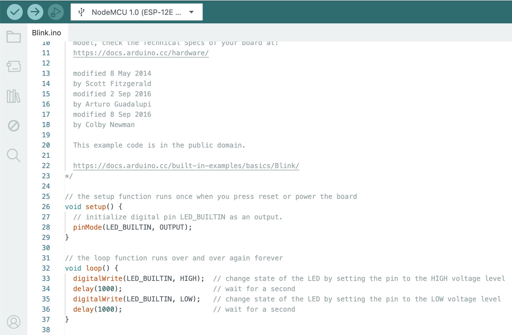

# Blinkprogram på NodeMCU (ESP8266)


## Vad är Blinkprogram?

Här lär vi oss vad ett Blinkprogram är och hur man kan få en LED-lampa att tändas och släckas med hjälp av NodeMCU. Vi tittar på hur en mikrokontroller fungerar, hur man skriver kod i Arduino IDE och hur man styr en LED med hjälp av digitala signaler. Det är ett bra första steg för att förstå programmering.

## Mikroprocessor

NodeMCU använder mikroprocessorn ESP8266. Den kan programmeras med Arduino IDE och har digitala pinnar som kan användas för att ansluta olika komponenter, till exempel LED-lampor och sensorer.

NodeMCU ansluts till datorn med en USB-kabel. Koden skrivs i Arduino IDE och laddas sedan upp till kortet.


## Två grundfunktioner i Arduino

Arduino-program använder två viktiga funktioner:

- `setup()` körs en gång när programmet startar. Här görs inställningar, till exempel vilka pinnar som ska användas.
- `loop()` körs om och om igen. Här skriver man koden som ska upprepas.

## Portinitialisering

För att kunna styra en LED måste pinnen ställas in som en utgång. Detta görs med `pinMode()`.

Exempel:

`pinMode(LED_BUILTIN, OUTPUT);`

´LED BUILTIN´ är pinnen som används. `OUTPUT` betyder att mikroprocessorn ska skicka en signal ut från pinnen.

## Så fungerar koden

När programmet startas ställs LED-pinnen in som en utgång. Sedan upprepar programmet samma moment. I Blinkprogrammet skickas först en HIGH-signal till LED pinnen. LED-lampan tänds och väntar i en sekund. Sedan skickas en LOW-signal och lampan släcks. Detta upprepas hela tiden.

- `digitalWrite(HIGH)` – tänder LED-lampan.
- `digitalWrite(LOW)` – släcker LED-lampan.
- `delay(1000)` – väntar i 1000 millisekunder, alltså en sekund.

## Kodexempel

C++ är ett programmeringsspråk som används för att styra mikrokontroller. I Arduino IDE skriver vi kod för att bestämma vad NodeMCU ska göra.

```c++

void setup() {
  pinMode(LED_BUILTIN, OUTPUT);
}

void loop() {
  digitalWrite(LED_BUILTIN, HIGH);
  delay(1000);

  digitalWrite(LED_BUILTIN, LOW);
  delay(1000);
}
```

Här visas ett exempel på ett Blinkprogram i Arduino IDE. Programmet tänder LED-lampan i en sekund och släcker den i en sekund.




## Användning i grupp projektet

I vårt projekt ska vi mäta hur mycket vatten en katt dricker. Samma princip med digitala signaler kan användas för att styra en LED. Till exempel kan en LED tändas om vattennivån är låg och visa att katten behöver mer vatten.

## Resultat

Med Blinkprogrammet lär vi oss hur en mikroprocessor kan styra en komponent genom att skicka signaler från en digital pin.
